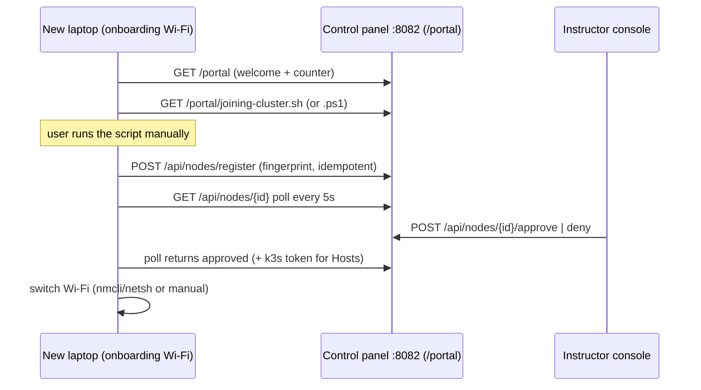

# LAN Onboarding Portal (Connection Approval Gate)

Status: **implemented** (checkpoint 41). The soft-portal enrollment flow ships in the
control panel binary; gateway-level enforcement is a designed follow-up.

## What it is

A captive-style portal hosted entirely inside the control panel (`:8082`), reachable
**before** a device is approved. A laptop that joins the onboarding Wi-Fi gets:

1. A welcome page with download links and a **live download counter**.
2. `joining-cluster.sh` (Linux/macOS) or `joining-cluster.ps1` (Windows) — the
   enrollment scripts.
3. The approval workflow: script registers the laptop → instructor Allow/Deny on the
   existing admin console (`control.ros-platform.local` → Instructor console) → laptop
   switches to the cluster network.

No internet access is required at any point: portal, scripts, and counter APIs are all
served from the master laptop.

## Network layout

```
onboarding Wi-Fi (AP on master)          cluster router (separate device)
  └─ new laptop, unapproved               └─ approved laptops + K3s traffic only
        │  http://<master-ip>:8082/portal
        ▼
  master laptop
  ├─ onboarding AP (hostapd + dnsmasq)     ← infrastructure, not in the repo
  ├─ K3s (control plane + Traefik)
  └─ control panel :8082 (hostNetwork)
     ├─ /portal                 welcome page (no auth — by design)
     ├─ /portal/joining-cluster.{sh,ps1}
     ├─ /api/downloads/count    public aggregate counter
     └─ /api/downloads/stats    JWT-gated detail for the admin console
```

**Traffic separation is physical**: the master hosts the onboarding AP only; the
cluster router carries all cluster traffic. The master laptop is never a router.

## Enrollment flow



### The scripts (`joining-cluster.sh`, `joining-cluster.ps1`)

Both mirror `join-cluster.sh`'s hardware gate (≥8 cores, ≥16 GB, NVIDIA ⇒ Host) and:

- Find the panel via `PANEL_URL` env → mDNS (`_ldndrc-master._tcp`) → interactive prompt.
- Register with retries. **Idempotent**: the panel deduplicates by hardware
  fingerprint, so re-running after a failure reuses the same join request.
- Poll until `approved` / `denied` / `expired`; denied shows the operator's reason.
- Attempt the cluster Wi-Fi switch (`nmcli --ask` / `netsh wlan connect`) with manual
  fallback instructions printed on any failure.
- Approved **Hosts** are offered the K3s agent install (confirm prompt; sudo; uses
  `K3S_INSTALL_URL`, default `https://get.k3s.io`). Guests stop after approval —
  browser-only. Windows laptops always enroll as Guests (k3s agents are Linux-only).

The status the script displays comes exclusively from the panel — a client cannot
assert its own approval, and actual network access is enforced by the gateway, not by
the script or the UI.

### `--detect-only` and `test-joining.sh`

`joining-cluster.sh --detect-only` prints the detection/decision lines and exits — no
network. `test-joining.sh` (repo root) runs five threshold scenarios against it,
mirroring `test-join.sh`.

## Download counter

### Semantics (deliberate)

| Metric | Counts | Visible to |
|---|---|---|
| `requests` | Every artifact endpoint hit: HEAD probes, Range/partial fetches, retries, aborted transfers, 304s | Admin only |
| `downloads` | Full `200` GET responses whose entire body reached the client | Public (aggregate) |
| `devices` | Distinct `sha256(salt ‖ IP ‖ User-Agent)` per artifact | Admin only |

**A served download does not prove anything about the client.** The server knows the
bytes left the NIC; it cannot know whether the user saved the file, ran it, or whether
the transfer was a browser retry. The portal page says this in plain text, and so does
this doc. Treat the counter as engagement telemetry, not conversion data.

### Storage & accuracy

- JSON file at `DOWNLOADS_DB` (default `/var/lib/ldndrc/downloads.json`), following the
  `nodes.json`/`sessions.json` pattern: mutex-guarded, atomic tmp+rename on every
  mutation. Concurrent increments are serialized and exact (tested with parallel
  writers).
- Persists across server restarts and container restarts. Same caveat as the other
  panel stores: the Deployment uses an `emptyDir` volume, so counts reset on pod
  redeploy. Move all three DBs to a PVC in the same change if this ever matters.
- A random per-DB `salt` is persisted with the counts so the unique-device hashes stay
  stable across restarts.

### Privacy

The public count endpoint exposes aggregate totals only. IP addresses, user agents,
and device hashes never leave the server; even the admin stats endpoint shows counts,
not values. IP+UA hashing is **not identity** — both are spoofable, and the unique
metric is directional. MAC addresses are deliberately not used.

## API reference (additions to the panel)

| Method | Path | Auth | Purpose |
|---|---|---|---|
| `GET` | `/portal`, `/portal/` | none | Welcome page (live counter, run instructions) |
| `GET` | `/portal/joining-cluster.sh` | none | Script download (counts served downloads) |
| `GET` | `/portal/joining-cluster.ps1` | none | Windows script download |
| `GET` | `/api/downloads/count` | none | `{"artifacts":{"joining-cluster.sh":N,...},"total":T}` |
| `GET` | `/api/downloads/stats` | JWT | Adds per-artifact `requests`/`devices` + `unique_devices` |

Also changed: node IDs are now 128-bit (32 hex chars) instead of 32-bit. The ID doubles
as the enrollment bearer capability for polls/diagnostics — knowledge of the ID is the
token, never IP/MAC. Existing stored IDs keep working.

## Onboarding AP setup (master laptop, infrastructure)

Not part of the Go app — the master hosts a second Wi-Fi network with
`hostapd` + `dnsmasq`, firewalled so unapproved clients reach only `:8082`:

```bash
sudo apt install hostapd dnsmasq
# /etc/dnsmasq.d/ldndrc-onboarding.conf:  serve 192.168.4.x DHCP; all DNS
# answers → 192.168.4.1 so bare http:// attempts land on the panel.
# /etc/hostapd/hostapd.conf:             ssid=ldndrc-onboarding, 2.4GHz, WPA2.
# nftables:                              allow udp 67,53 + tcp → :8082; drop the rest.
sudo systemctl enable --now hostapd dnsmasq
```

Because the soft portal does not redirect, students open `http://<master-ip>:8082`
(the dnsmasq wildcard-DNS trick above makes most browser attempts land there anyway).
The mDNS advertiser (`_ldndrc-master._tcp`, already in the panel) also answers
"where is the master" for scripts using `avahi-browse`.

## Gateway enforcement (designed follow-up)

Approval state lives in the panel; enforcement lives at the gateway. To keep them
decoupled (and vendor-neutral), the core deliberately ships **no** enforcement code.
The later integration contract:

```
GET /api/gateway/devices            (JWT or gateway-shared secret)
→ {"devices":[{"id":"…","status":"approved","mac":"…","ip":"…"}]}
```

A gateway integration (OpenWrt script, hostapd helper, or any router with an API) polls
this endpoint and applies allow/deny rules to the radio interface. Nothing in
`internal/portal` or `internal/nodes` changes; the panel already treats approval as
data, not enforcement. Options for extending `nodes.Node` with `mac`/`last_ip` at
registration time are described in the checkpoint 41 notes.
