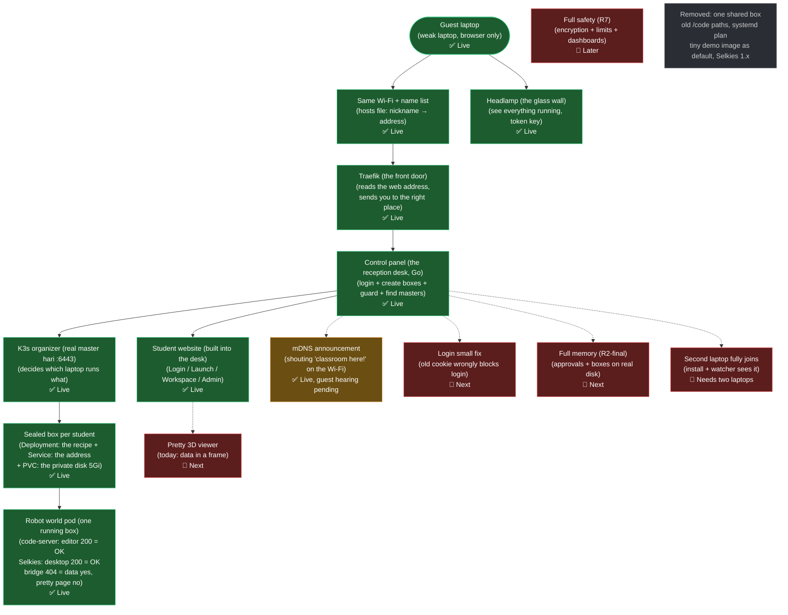
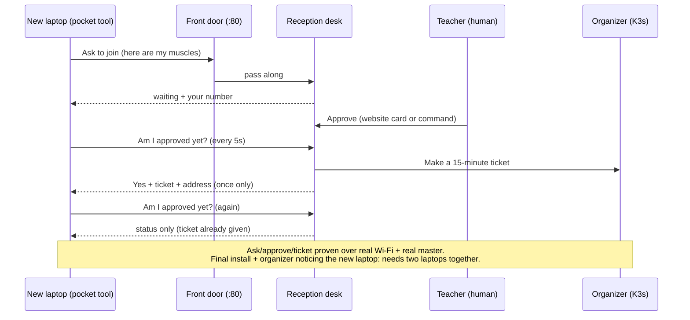

# LDNDRC Project Journey — A Newcomer's Guide (Visual Report)

> Companion to `docs/roadmap.md` (what is left, in build order) and
> `local_dev_docs/detailed-project-report.md` (technical appendix with proofs).
> This document is the *friendly front door*: what the finished classroom
> looks like, what works today, what is left, and why we built it this way.
> Mermaid diagrams render on GitHub/GitLab; a plain-text fallback follows each one.
>
> **Last updated:** 2026-10-13 · `main@299702f` (merges `d9d9a28` R2/R3/R4 +
> `e5fe6cb` R6, checkpoints CP01–CP39). Written for a new contributor with
> no prior context. Jargon is explained in (brackets: plain words) on first use.

## Colour legend (used in every diagram)

| Colour | Meaning (plain words) |
|---|---|
| Green | Built and tested on real machines — it works today |
| Amber | Built but half-ready — a demo, a rehearsal, or waiting on real hardware proof |
| Red | Missing — real work left to do |
| Grey | Removed — we tried it, then replaced it with something better |

## 0. New here? Start here (2 minutes)

LDNDRC turns a room full of laptops into a robotics classroom with no cloud and no server room:

- **Hosts (strong laptops that share their power).** A gaming or workstation laptop with a good CPU and ideally an NVIDIA graphics card (GPU: the chip that draws 3D pictures fast). It runs the heavy robot software.
- **Guests (weak laptops that just watch and type).** Any old laptop with a browser (Chrome/Firefox). The student writes code and sees the 3D robot world — nothing is installed.
- **Master (the first laptop, the organizer).** One laptop starts the cluster (K3s: a lightweight organizer that decides which laptop runs what) and keeps the list of who is allowed in.
- **Session (one student's private robot world).** When a student clicks "Launch", the Master creates a sealed box for them: their own code editor, their own simulated robot, their own desktop. Two students can both drive a topic called `/cmd_vel` (the "please move" message) and never interfere — each box hears only itself.
- **Control panel (the reception desk).** A small program written in Go (a fast, single-file language) that handles login, creates sessions, checks permissions, and forwards browser clicks to the right box.
- **Gateway (the traffic guard).** The part of the control panel that checks "are you logged in?" and then forwards you to your box's editor, desktop, or simulation view.

A normal day, end to end: student opens the classroom website → logs in → clicks Launch → waits about 20 seconds while their box starts → writes robot code in the browser editor → watches their TurtleBot3 (a small teaching robot) move in the 3D view → stops the session. A teacher opens the Admin page, sees who has a box running, and approves new laptops that want to share power.

## 1. Final dream vs what exists now (the comparison)

The "final dream" is `plan.md` (the original design, Phases 1–5) plus R7 (making it safe and sturdy for real classes):

- **Final:** many laptops join with one click; every student gets code + 3D sim + desktop in the browser; login is safe (encrypted traffic = TLS, fake-request protection = CSRF); boxes survive restarts; works on Windows too; teachers see dashboards and limits.
- **Now (Oct 2026, `main`):** one real organizer laptop (`hari`, `192.168.1.37:6443`) runs everything; students do get code + desktop + sim-data through the browser; login has fake-request protection but no encryption yet; boxes survive small restarts but not big ones; new laptops can ask to join and be approved, but the final automatic "become part of the cluster" step still needs a paired test with two real laptops.

```mermaid
flowchart LR
    classDef done fill:#1d5c2e,stroke:#3ecf8e,color:#fff
    classDef part fill:#6b4e12,stroke:#f5b86c,color:#fff
    classDef missing fill:#5c1d1d,stroke:#f56c6c,color:#fff

    subgraph FINAL["Final dream (plan.md + R7)"]
        F1["Many laptops share power<br/>(one-click join, Windows too)"]:::missing
        F2["Code + 3D sim + desktop<br/>in the browser"]:::missing
        F3["Safe login<br/>(encrypted TLS + CSRF)"]:::missing
        F4["Survives restarts<br/>(memory on disk)"]:::missing
        F5["Teacher view + limits<br/>(dashboards, quotas)"]:::missing
    end

    subgraph NOW["Now (Oct 2026, main)"]
        N1["One real organizer (hari)<br/>+ browser website live"]:::done
        N2["Code 200 + Desktop 200<br/>live (sim data, viewer next)"]:::done
        N3["Login + CSRF live<br/>(TLS next)"]:::part
        N4["Survives small restarts<br/>(big ones next)"]:::part
        N5["Admin cards live<br/>(limits next)"]:::part
    end

    NOW -.->|"left to build"| FINAL
```



```text
ASCII fallback:

FINAL DREAM: many laptops join easily | code+sim+desktop in browser |
  safe encrypted login | survives restarts | teacher dashboards and limits.
NOW: one organizer laptop live | code+desktop live, sim viewer next |
  login safe-ish (encryption next) | survives small restarts (big next) |
  admin cards live (limits next).
```

| Area (plain words) | Final dream | Now | Status |
|---|---|---|---|
| Joining (adding a laptop's power) | Any laptop clicks once and joins, including Windows | Ask → approve → token works; the final install step needs a two-laptop test | Partly |
| Student website | Login → Launch → code + 3D picture + desktop | Login → Launch → code + desktop live; 3D picture shows data, pretty viewer next | Partly |
| Robot world (the sealed box) | Full ROS 2 (robot brain) + Gazebo (3D physics world) + TurtleBot3 moving | Live: 10.8GB image, TurtleBot3 `empty` world moves at full speed on CPU | Live |
| Safety (who can do what) | Encrypted traffic (TLS: scrambled so Wi-Fi snoopers can't read) + fake-request tokens (CSRF: proof the click came from our own site) | CSRF live; TLS missing | Partly |
| Memory (remembering after a restart) | Boxes and approvals live on disk, nothing lost | Small restarts lose nothing; big redeploys still lose track (fix queued) | Partly |
| Teacher view | Who runs what, approve laptops, usage limits | Approve laptops + see sessions live; limits and dashboards later | Partly |

## 2. How it fits together (architecture with brackets)

Read the boxes top to bottom: your laptop at the top, the organizer in the middle, the sealed robot boxes at the bottom.



```text
ASCII fallback:

Your laptop --Wi-Fi--> front door (:80) --> reception desk (Go program)
  --> website (Login/Launch/Workspace/Admin) + organizer (:6443)
  --> sealed box per student (recipe + address + 5GB disk)
  --> robot world (editor OK, desktop OK, sim data OK)
You can also peek through the glass wall (Headlamp).
Still to build: login small fix, full memory on disk, pretty 3D viewer,
  second laptop fully joining, full safety (encryption + limits).
Removed along the way: one shared box, old web paths, systemd plan,
  tiny demo image as default, Selkies 1.x installer.
```

### Bracket glossary (every hard word, in plain words)

| Word you will see | What it means (simple) |
|---|---|
| K3s (organizer) | A lightweight boss program. You tell it "I want one box for student A", it starts it, watches it, restarts it if it dies. |
| Traefik (front door) | Reads web addresses like `editor.ros-platform.local` (editor = code, desktop = screen, gazebo = sim data, control = desk) and forwards you. `:80` is normal web traffic, `:443` is encrypted web traffic. |
| Control panel / reception desk | Our Go program. Handles login, creates boxes, checks tickets, serves the website, guards the doors. |
| Session / sealed box | One student's private world. Three Kubernetes objects: Deployment (the recipe: which picture + how much CPU), Service (the address + doors 7682/8080/9002), PVC (the private 5GB disk that keeps homework). |
| Pod (running box) | The recipe actually running. Has an ID (name), an owner (student), a status (starting → ready → stopped), and a ROS domain number (a channel so boxes can't hear each other). |
| code-server (editor, door 7682) | Real VS Code in the browser. `200` means "OK, here is the editor". `302 → 200` means "one quick redirect, then the editor". |
| Selkies (desktop stream, door 8080) | Live screen sharing in the browser (click, type, terminal). `200` = picture arrives. Old `502` meant "nothing listening yet" — that era is over. |
| Gazebo bridge (sim data, door 9002) | The robot world's data pipe (positions, laser scans, clock). `404` here means "pipe alive, but no pretty page at `/`" — data yes, viewer next. |
| ROS 2 Jazzy + Gazebo Harmonic | The robot brain (Jazzy) and the 3D physics world (Harmonic). TurtleBot3 is a small teaching robot we drive in the `empty` practice world. |
| Headlamp (glass wall, `:8080`) | A dashboard to see everything running. Needs a token (a temporary key). |
| mDNS announcement | The organizer shouting "classroom here!" on the Wi-Fi so new laptops can find it without typing addresses. Guest laptops hearing it is still pending. |
| Bootstrap token (join ticket) | A one-time password the organizer mints (valid 15 minutes) so a new laptop can join. Second ask gets "status only" — the ticket is given once. |
| CSRF token (proof the click is ours) | A secret stamp the login gives the website. Every change (create/stop/approve) must show it, so a bad website can't trick your browser into clicking. `403` = "no valid stamp, blocked". `401` = "not logged in". |
| `sessions.json` (the notebook) | A small file where the desk writes down every box. On restart it re-reads the notebook: box still there → adopt (keep it); box gone → mark `stopped` (never silently delete). |
| `SESSION_IMAGE` (which picture) | Which sealed-box picture to use. Today `ldndrc/ros2-gz:jazzy-harmonic-10f1f10c` (10.8GB, the real world). The tiny demo picture is retired. |
| hostNetwork + delete-old-first | The desk runs directly on the organizer's network (so it can shout mDNS). Only one fits on door `:8082`, so updates must delete the old copy first — never plain restart. |

Live snapshot behind this map (real master `hari`, CP33/CP35/CP37): box `ready` in ~20 seconds (picture pre-loaded, no download wait); editor shows the IDE; desktop shows the Selkies page; sim pipe answers with data; wrong or missing login correctly blocked; Admin page shows user/session/laptop cards and approve/deny works. Update rule: delete the old desk copy first, picture tarball (2.4GB packed, 10.8GB unpacked) lives in `$HOME` because `/tmp` is too small and wiped on reboot.

## 3. Mind-map: what is built vs what is left (+ the journey order)

### 3a. Mind-map (the "what" — good for orienting)

> Drawn as a hub-and-spoke flowchart (same mind-map idea, but renders on
> every viewer). The native `mindmap` keyword was tried first and broke:

```mermaid
flowchart TB
    classDef root fill:#0b0e14,stroke:#7c6cf5,color:#fff,stroke-width:3px
    classDef done fill:#1d5c2e,stroke:#3ecf8e,color:#fff
    classDef half fill:#6b4e12,stroke:#f5b86c,color:#fff
    classDef next fill:#5c1d1d,stroke:#f56c6c,color:#fff

    ROOT(["LDNDRC classroom cluster<br/>(hub = what is built vs left)"]):::root

    EXP["Student experience ✅<br/>(mostly live)"]:::done
    JOIN["Cluster and joining 🟡<br/>(half done)"]:::half
    WORLD["Robot world ✅<br/>(live)"]:::done
    SAFE["Safety and memory 🟡<br/>(half done)"]:::half
    VIEW["Teacher view 🟡<br/>(half done)"]:::half

    ROOT --> EXP & JOIN & WORLD & SAFE & VIEW

    EXP --> E1["Login ✅ live"]:::done
    EXP --> E2["Launch button ✅ live"]:::done
    EXP --> E3["Code editor ✅ live"]:::done
    EXP --> E4["Desktop screen ✅ live"]:::done
    EXP --> E5["Sim data ✅ live"]:::done
    EXP --> E6["Pretty 3D viewer 🔴 next"]:::next

    JOIN --> J1["Ask to join ✅ live"]:::done
    JOIN --> J2["Approve laptops ✅ live"]:::done
    JOIN --> J3["One-time ticket ✅ live"]:::done
    JOIN --> J4["Wi-Fi announce 🟡<br/>(shouting live, hearing pending)"]:::half
    JOIN --> J5["Second laptop install 🔴<br/>(needs two laptops)"]:::next

    WORLD --> W1["Real 10.8GB picture ✅ live"]:::done
    WORLD --> W2["TurtleBot3 moves ✅ live"]:::done
    WORLD --> W3["Offline models ✅ live"]:::done
    WORLD --> W4["GPU sharing 🔴 later"]:::next

    SAFE --> F1["Click protection ✅ live"]:::done
    SAFE --> F2["Login small fix 🔴 next"]:::next
    SAFE --> F3["Small-restart memory ✅ live"]:::done
    SAFE --> F4["Full-disk memory 🔴 next"]:::next
    SAFE --> F5["Encryption and limits 🔴 later (R7)"]:::next

    VIEW --> V1["See sessions ✅ live"]:::done
    VIEW --> V2["Approve laptops ✅ live"]:::done
    VIEW --> V3["Dashboards 🔴 later"]:::next
```

> it cannot handle `(` `)` or `<br/>` inside labels.



```text
ASCII fallback (mind-map):

LDNDRC
├── Student experience ✅ (login, launch, editor, desktop, sim data live; pretty viewer next)
├── Cluster+joining 🟡 (ask/approve/ticket live; announce half; install needs two laptops)
├── Robot world ✅ (real picture, TurtleBot moves, offline models; GPU later)
├── Safety+memory 🟡 (click-protection + small-restart live; login fix + full memory + encryption next)
└── Teacher view 🟡 (see + approve live; dashboards later)
```

### 3b. Journey flowchart (the "in what order" — good for history)

```mermaid
flowchart LR
    classDef done fill:#1d5c2e,stroke:#3ecf8e,color:#fff
    classDef prov fill:#6b4e12,stroke:#f5b86c,color:#fff
    classDef missing fill:#5c1d1d,stroke:#f56c6c,color:#fff
    classDef gone fill:#2a2d34,stroke:#6b7280,color:#ccc

    GEN["Start<br/>idea + first scripts"]:::done
    FND["Foundation CP01–04<br/>(join check, desk skeleton,<br/>recipes, design)"]:::done
    SES["One box per student CP05–06<br/>(recipe + address + disk)"]:::done
    GATE["Doors CP07 + R1<br/>(login guard + names,<br/>old paths deleted)"]:::done
    PROOF["Proof CP08–10<br/>(tests + live + glass wall)"]:::done
    DEMO["Demo CP11–12<br/>(GPU optional + tiny picture)"]:::done
    JOIN["Welcoming CP14–19<br/>(ask/approve/ticket<br/>+ pocket tool + releases)"]:::done
    REAL["Real organizer CP20<br/>(k3d demo → real hari<br/>+ 2 real bug fixes)"]:::done
    SAFE["Safe + memory CP21<br/>(R3 click-guard + R2 notebook)"]:::done
    SITE["Website CP22–26<br/>(R4 Login/Launch/<br/>Workspace/Admin)"]:::done
    WORLD["Real world CP27–38<br/>(10.8GB + desktop 200<br/>+ sim at full speed)"]:::done
    ONE["One line CP39<br/>(both tracks merged)"]:::done
    YOU["YOU ARE HERE<br/>Oct 2026 main ✅"]:::prov
    NEXT["Next: login fix<br/>full memory, viewer"]:::missing
    TWOLAP["Two-laptop join<br/>(R5)"]:::missing
    STURDY["Sturdy (R7)<br/>+ Windows + docs"]:::missing
    OLD["Replaced: shared box,<br/>old paths, systemd,<br/>tiny default, Selkies 1.x"]:::gone

    GEN --> FND --> SES --> GATE --> PROOF --> DEMO --> JOIN --> REAL --> SAFE --> SITE --> WORLD --> ONE --> YOU --> NEXT --> TWOLAP --> STURDY
```



```text
ASCII fallback (order):

idea → foundation → one-box-per-student → doors → proof → demo
  → welcoming → real organizer → safe+memory → website → real world
  → one line => YOU ARE HERE => login fix/memory/viewer => two-laptop join => sturdy
Replaced: shared box, old paths, systemd, tiny default, Selkies 1.x.
```

### Journey chapters in plain English (the story, 7 chapters)

1. **Getting started (idea + first scripts).** We wrote the classroom plan, a script that checks a laptop's muscles (CPU = thinking cores, RAM = short-term memory, GPU = picture chip), and tests that fake strong/weak laptops to prove the check works.
2. **One box per student (the big fix).** First we planned one shared room; we replaced it with sealed boxes. Each student gets recipe + address + private disk, a unique channel number, and localhost-only robot chatter (robots talk inside their own box, never across boxes).
3. **Opening the doors (guard + names).** The desk learned to check login cookies (a wristband after login) and web-address names (`editor.` vs `desktop.` vs `gazebo.`). Old hallway paths (`/code`, `/sim`) were demolished after live proof.
4. **Seeing what runs (proof + glass wall).** Automatic tests, then live tests on a demo cluster, then Headlamp so teachers can watch boxes from a second laptop over the Wi-Fi.
5. **Welcoming new laptops (ask → approve → ticket).** A joining laptop says "here are my muscles" → teacher approves → organizer mints a 15-minute ticket (given once) → pocket tool (`ldndrc-join`: a small program with a friendly text screen) installs. Proven laptop-to-organizer over real Wi-Fi; full install waits for two laptops together.
6. **Real organizer + website (no more demo).** We moved from a pretend cluster (k3d: cluster-in-a-box for practice) to a real K3s on `hari`, fixed two real bugs found only there (Wi-Fi wildcard DNS eating our addresses → trailing-dot fix; update deadlock → delete-old-first rule), added click-protection + the notebook that remembers boxes, and built the student website (Login → Launch stepper → Workspace with Code/Sim/Split + Desktop + Admin cards).
7. **Real robot world (the heavy lifting).** Built the 8.25GB base, then the 10.2GB world (Selkies broken upstream → shipped editor+sim first), proved it boots, froze it with version tags, flipped the live cluster to it, then added Selkies 2.0 (desktop picture live) and pre-packed the two 3D models (Ground Plane + Sun) so the robot moves even with no internet — full speed on plain CPU. Recorded the packing math (2.4GB to send, 10.8GB on disk). Merged both tracks into one `main`.

## 4. Joining flow (how a laptop is welcomed, step by step)



```text
ASCII fallback:

laptop --ask--> desk (waiting + number) | teacher approves
  | laptop polls --> desk makes 15-min ticket --> ticket once
  | later polls --> status only.
Proven on real Wi-Fi; final install awaits the paired run.
```

Today: ask/approve/ticket/cleanup all work, including from the Admin cards. The pocket tool's screens are built and tested; the final step (actually installing the agent software and the organizer marking it `joined`) is red — it needs two physical laptops in one room.

## 5. Decision graph (why we built it this way — tech + method + rejected)

How to read: each block is `Need → Chosen (tech + how we proved it) → Rejected (what we dropped and why)`. This is the branch-by-branch map you asked for.

```mermaid
flowchart TB
    classDef need fill:#3a3f4b,stroke:#8b93a7,color:#fff
    classDef chose fill:#1d5c2e,stroke:#3ecf8e,color:#fff
    classDef rej fill:#2a2d34,stroke:#6b7280,color:#ccc

    N1["Need: desk language"]:::need
    C1["Chosen: Go, one static file<br/>(method: unit + live on cluster)"]:::chose
    R1["Rejected: NestJS/Node<br/>(needs a runtime, heavier)"]:::rej
    N1 --> C1 --> R1

    N2["Need: one world per student"]:::need
    C2["Chosen: Deployment+Service+PVC per student<br/>(method: two-user live test, 403s)"]:::chose
    R2["Rejected: fixed StatefulSet + shared Service<br/>(not flexible, demolished R1)"]:::rej
    N2 --> C2 --> R2

    N3["Need: browser doors"]:::need
    C3["Chosen: cookie wristband + web-address names<br/>(method: live 200/401/404 matrix)"]:::chose
    R3["Rejected: path routing /code /sim<br/>(collides, removed)"]:::rej
    N3 --> C3 --> R3

    N4["Need: run the desk"]:::need
    C4["Chosen: in-cluster Deployment + client-go<br/>(method: live rollout, RBAC probes)"]:::chose
    R4["Rejected: root systemd unit<br/>(outside the cluster, amended)"]:::rej
    N4 --> C4 --> R4

    N5["Need: join tickets"]:::need
    C5["Chosen: bootstrap Secrets, 15-min, once-only<br/>(method: Wi-Fi live mint + cleanup)"]:::chose
    R5["Rejected: CLI-minted tokens<br/>(manual, less safe)"]:::rej
    N5 --> C5 --> R5

    N6["Need: weak demo machines"]:::need
    C6["Chosen: GPU optional flag (0 = skip)<br/>(method: scheduler refusal + schedule proofs)"]:::chose
    R6["Rejected: faking GPU capacity<br/>(lies to the scheduler)"]:::rej
    N6 --> C6 --> R6

    N7["Need: prove plumbing fast"]:::need
    C7["Chosen: tiny 82MB stand-in first, real image later<br/>(method: stand-in 200s, then R6 flip)"]:::chose
    R7["Rejected: big-bang 10GB on day one<br/>(blocks everyone)"]:::rej
    N7 --> C7 --> R7

    N8["Need: pocket join tool UI"]:::need
    C8["Chosen: Bubble Tea text screens<br/>(method: keypress matrix + 3-OS builds)"]:::chose
    R8["Rejected: Fyne/Electron apps<br/>(signing + budget pain)"]:::rej
    N8 --> C8 --> R8

    N9["Need: fake-click safety (R3)"]:::need
    C9["Chosen: HMAC stamp over login, checked on changes<br/>(method: 7 guard + 5 binding tests + live 403s)"]:::chose
    R9["Rejected: nothing (rely on Bearer only)<br/>(SPA needs cookie safety)"]:::rej
    N9 --> C9 --> R9

    N10["Need: remember boxes (R2)"]:::need
    C10["Chosen: sessions.json notebook + adopt/mark-stopped<br/>(method: kill-restart, zero orphans)"]:::chose
    R10["Rejected: silent-delete or silent-rebuild<br/>(hides loss)"]:::rej
    N10 --> C10 --> R10

    N11["Need: student website (R4)"]:::need
    C11["Chosen: Vite+React built INTO the Go file<br/>(method: webbuild stage, live bundle 200s)"]:::chose
    R11["Rejected: sidecar web server<br/>(second thing to deploy)"]:::rej
    N11 --> C11 --> R11

    N12["Need: desktop picture"]:::need
    C12["Chosen: Selkies 2.0 pure-Python behind a flag<br/>(method: local 200 + live 200)"]:::chose
    R12["Rejected: Selkies 1.6.2 installer<br/>(upstream deleted the files, 404)"]:::rej
    N12 --> C12 --> R12

    N13["Need: sim works offline"]:::need
    C13["Chosen: pre-pack 2 models (68K) into the picture<br/>(method: no-network container + live RTF)"]:::chose
    R13["Rejected: download at start<br/>(Wi-Fi wildcard DNS eats it)"]:::rej
    N13 --> C13 --> R13

    N14["Need: ship 10GB pictures"]:::need
    C14["Chosen: version tags + 2.4GB tarball in $HOME<br/>(method: import 164s→28s, ~4.5x)"]:::chose
    R14["Rejected: :latest + /tmp<br/>(untracked + too small + wiped)"]:::rej
    N14 --> C14 --> R14
```



```text
ASCII fallback (decisions, need → chosen → rejected):

1 desk language → Go one-file (tested live) → not Node (heavy).
2 one world each → per-student recipe+address+disk (two-user proof) → not shared box.
3 doors → cookie + names (live matrix) → not /code paths.
4 run desk → inside cluster (live rollout) → not systemd.
5 tickets → 15-min once-only Secrets (Wi-Fi proof) → not manual CLI.
6 weak machines → GPU-optional flag → not faked capacity.
7 fast proof → tiny picture first, real later → not 10GB day one.
8 pocket tool → text screens (3-OS builds) → not heavy apps.
9 click safety → HMAC stamp on changes (live 403s) → not nothing.
10 memory → notebook + adopt/mark-stopped (zero orphans) → not silent delete.
11 website → built into Go file → not sidecar server.
12 desktop → Selkies 2.0 behind flag (200 live) → not dead 1.6.2.
13 offline sim → pre-pack 2 models (full speed) → not download at start.
14 shipping → version tags + $HOME tarball → not latest + /tmp.
```

## 6. What is left (in order — pick the top row)

| # | Task (plain words) | What "done" looks like | Size |
|---|---|---|---|
| 1 | Login small fix: old cookie wrongly blocks login (`guardCSRF` must skip the login door) | Login works with and without old cookies; live proof; tidy the stale Selkies comment in the same change | < half a day |
| 2 | Full memory (R2-final): approvals + boxes onto a real disk; desk updates without deadlock (`maxUnavailable: 1`) | Big redeploy loses nothing; no lost boxes in `kubectl get` | 0.5–2 days |
| 3 | Pretty 3D viewer: put the `sim-web-app/` gzweb picture into the website (replaces the data frame); try `world`/`house` robots | Moving 3D TurtleBot3 in the browser | half a day |
| 4 | Two-laptop join (R5): second laptop asks → approve → ticket → install → organizer sees it → box runs on it; plus hear the Wi-Fi shout | Needs two physical laptops; run `acceptance-second-laptop.sh` (needs `MASTER_IP`, never hardcode — Wi-Fi addresses move) | days |
| 5 | Windows/WSL2 proof + tidy docs (P5/P6): retire `join-cluster.sh` (old bash path), refresh `plan.md` | Windows laptop joins; old script sunset | days |
| 6 | Sturdy for classes (R7): encrypted traffic (TLS), per-box walls (NetworkPolicy), per-student limits (quotas), watch screens (Prometheus/Grafana) | Safe beyond one trusted Wi-Fi room | ongoing |
| ∥ | Picture follow-ups (parallel): share via a local picture shelf (registry mirror, worth it at ~5 laptops), wake-up pre-load, optional slimming (~1–1.5GB), GPU sharing on real NVIDIA hardware | Faster new-laptop setup | half a day each |

How to contribute: take the top unfinished row → read its checkpoints in `local_dev_docs/` (CP39 → backwards) → build → prove with the listed check → write a new `checkpoint-NN-*.md` in the CP style → move the YOU-ARE-HERE marker. Never plain-restart the desk on the organizer (delete the old copy first — door `:8082` fits only one).

Related: `docs/roadmap.md` (build-order tracker), `local_dev_docs/` (CP01–CP39 stories), `docs/local-cluster-headlamp.md` (runbook: start/stop, tokens, fixes).
