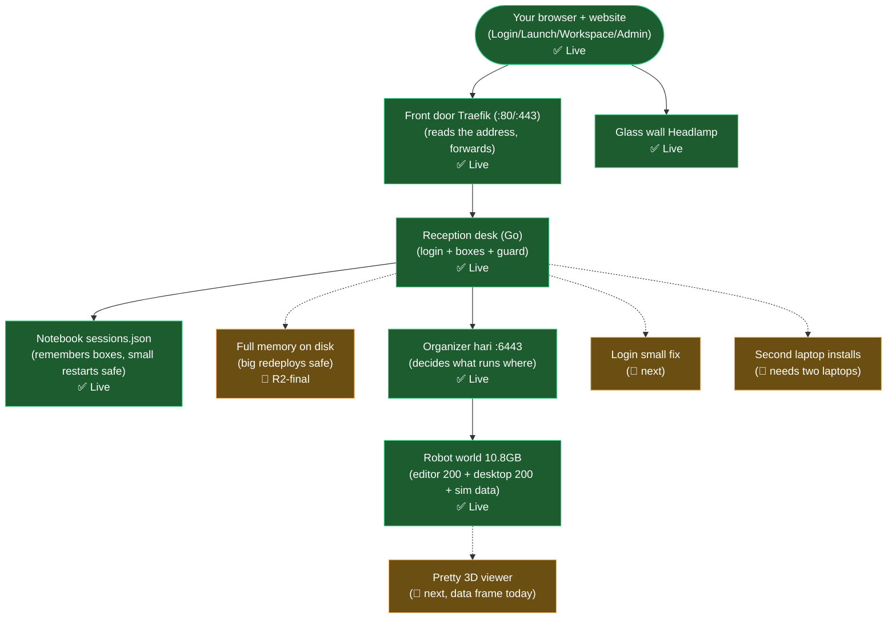

# LDNDRC Roadmap — What Is Built, What Is Left (Plain-English Tracker)

> Companion to `docs/project-journey-report.md` (the friendly front door:
> final-vs-now, mind-map, architecture with brackets, decision graph) and
> `local_dev_docs/detailed-project-report.md` (technical appendix).
> **§1 is the map** (green = works today, amber = half-ready, red = left).
> **§2 explains each leftover** in build order, in simple words.
> **§3 is the suggested order** with sizes. Mermaid renders on GitHub/GitLab;
> a plain-text fallback follows each diagram.
>
> **Last updated:** 2026-10-13 · `main@299702f` (R1/R2/R3/R4/R6 shipped, CP01–CP39).

## 1. The Map

### 1a. Journey (how we got here — plain names)

```mermaid
flowchart LR
    classDef done fill:#1d5c2e,stroke:#3ecf8e,color:#fff
    classDef next fill:#6b4e12,stroke:#f5b86c,color:#fff
    classDef later fill:#3a3f4b,stroke:#8b93a7,color:#fff

    START["Start<br/>(idea + scripts)"]:::done
    BOX["One box per student<br/>(CP05-06)"]:::done
    DOOR["Doors<br/>(guard + names, old paths gone)"]:::done
    PROOF["Proof<br/>(tests + live + glass wall)"]:::done
    WELCOME["Welcoming<br/>(ask/approve/ticket)"]:::done
    REAL["Real organizer<br/>(CP20 hari live)"]:::done
    SAFE["Safe + memory<br/>(R3 + R2 live)"]:::done
    SITE["Website<br/>(R4 Login..Admin live)"]:::done
    WORLD["Real world<br/>(R6 10.8GB live)"]:::done
    ONE["One line<br/>(CP39 merge)"]:::done
    YOU["YOU ARE HERE<br/>Oct 2026 main"]:::next

    FIX["Login fix + full memory<br/>+ pretty viewer"]:::next
    R5["Two-laptop join<br/>(R5)"]:::next
    STURDY["Sturdy: encryption,<br/>limits, dashboards (R7)<br/>+ Windows + docs"]:::later

    START --> BOX --> DOOR --> PROOF --> WELCOME --> REAL --> SAFE --> SITE --> WORLD --> ONE --> YOU --> FIX --> R5 --> STURDY
```



```text
ASCII fallback:

idea → one-box-per-student → doors → proof → welcoming → real organizer
  → safe+memory → website → real world → one line => YOU ARE HERE
  => login fix + full memory + viewer => two-laptop join => sturdy + Windows + docs.
```

### 1b. System (what works vs what is missing — same brackets as the journey doc)



```text
ASCII fallback:

browser --> front door --> desk --> notebook (small restarts safe).
desk --> organizer --> robot world (editor + desktop + sim data live).
Left: full disk memory, pretty viewer, login fix, second-laptop install.
Glass wall (Headlamp) live. Old paths removed (R1 done).
```

| Colour | Meaning |
|---|---|
| Green | Built and tested on real machines |
| Amber | Half-ready — works partly, needs the next step |
| Red | Missing — real remaining work |

## 2. What Is Left, In Build Order (simple words, with "done looks like")

### R1 — Old hallways removed (done, checkpoint-13)

Long ago the website used shared hallways (`/code`, `/sim`, `/stream`) into one shared room. We replaced them with named doors (`editor.`, `desktop.`, `gazebo.`) into private boxes and demolished the old hallways. Proof: only the desk's front door exists today; old `/code` answers `404` (not found, correct).

### R2 — Memory (shipped small, full version left)

**What it is:** the desk's notebook. Every time a box is created or stopped, the desk writes it in `sessions.json` (a small file). On restart it re-reads: box still running → keep (adopt); box gone → mark `stopped` (never pretend it still runs).

**Shipped (CP21):** small restarts lose nothing — proven by killing the container and seeing the same box ID come back, ready on first visit, editor OK first try.

**Left (R2-final):** big redeploys (whole copy replaced) still lose track because the notebook lives on a temporary shelf (emptyDir: wiped when the whole copy is replaced). Move notebook + laptop-approvals to a real disk (PVC: a disk Kubernetes keeps, or a small database), and let desk updates replace the old copy gracefully (`maxUnavailable: 1`: always keep one desk answering). Done looks like: replace the whole desk, zero lost boxes.

Size: half a day (disk) to days (database).

### R3 — Click safety (shipped, one small fix left)

**What it is:** proof each change-click came from our own website. Login hands the website a secret stamp (CSRF token: HMAC stamp = a fingerprint made with our secret key). Every create/stop/approve must show it or get `403` (blocked). Reads (looking at pages) need no stamp. The ask-to-join door stays open by design (strangers must knock) but is speed-limited.

**Shipped (CP21):** stamps checked live — no stamp → blocked, wrong stamp → blocked, correct stamp → through; editor still loads.

**Left (the arrival from the CP39 merge):** the login door itself wrongly demands a stamp, so a returning visitor with an old cookie gets blocked (`403`) instead of logged in. Fix: skip the stamp check on `/api/auth/login` + test + rebuild + delete-old-first rollout (delete the old desk copy first — door `:8082` fits only one) + live proof. Tidy the stale "Selkies deferred" comment in the same change.

Size: less than half a day.

### R4 — Student website (done, pretty viewer left)

**What it is:** the classroom site, built into the desk program (served from inside the Go file via `embed.FS`: the website files travel inside the desk binary; `web/dist/` build output is re-created, never committed). Pages: Login (enter) → Launch (big button + waiting stepper that asks "ready yet?" every 2 seconds, Cancel = delete) → Workspace (Code / Sim / Split side-by-side, both frames stay loaded so no reconnects, divider remembers its spot) → Desktop (full-screen button) → Admin (teacher cards).

**Shipped (CP22–CP26):** all pages live on the real organizer — login gives token + stamp + wristband cookie; Launch goes waiting → ready (~3rd check); editor and desktop pictures load; Admin shows people/session/laptop cards and approve/deny works on real rows.

**Left (viewer slice):** the Sim frame shows raw data today (bridge answers `404-with-data`: pipe alive, no pretty page). Put the `sim-web-app/` 3D viewer (gzweb: Three.js WebGL = 3D pictures drawn by the browser) into the page; smoke-test the `world`/`house` robots. Optional later: a see-everyone Admin feed, teacher-only glass-wall lock.

Size: half a day (viewer); the rest is done.

### R5 — Welcoming laptops (ask/approve live, full install needs two laptops)

**What it is:** zero-fuss joining. New laptop runs the pocket tool (`ldndrc-join`: small program, friendly text screens built with Bubble Tea): it measures muscles (CPU/RAM/GPU/disk — 25GB free required because the world picture is 10.8GB + first disk 5GB + room to breathe), finds the organizer (Wi-Fi shout = mDNS, or typed address `MASTER_IP` which is never guessed), asks to join (register: fingerprint + name), waits (poll: "approved yet?" every 5s), gets a 15-minute ticket once, installs the agent software (needs sudo password, never silent).

**Shipped:** ask/approve/ticket/lookup pages live (also as Admin cards); Wi-Fi shout live on the organizer; pocket tool builds for 3 systems; register→approve→ticket proven over real Wi-Fi and on the real organizer; disk math documented; rehearsal fixes merged (`4eeffea`).

**Left:** the paired run with two physical laptops: `acceptance-second-laptop.sh` end to end (register → approve → ticket → real agent install → organizer marks it joined → a box actually runs on the new laptop), the "no" path (deny), and hearing the Wi-Fi shout from the guest (`avahi-browse`). Old bash script stays until the pocket tool proves itself on real hardware.

Size: days; blocked on a second physical machine.

### R6 — Real robot world (done, share-faster follow-ups left)

**What it is:** the sealed-box picture. Base (8.25GB: Ubuntu + robot brain Jazzy + physics Harmonic + TurtleBot3) → world (code editor + 3D data pipe + desktop, `WITH_SELKIES` switch) → Selkies 2.0 (pure-Python screen sharing, sound off by nature) → pre-packed 3D models (Ground Plane + Sun, 64KB, so robots move with no internet) → frozen version tags (`:jazzy-harmonic-<sha>`, never `:latest`: always the exact tested picture).

**Shipped (CP27–CP38):** boots as student 1000, editor OK, desktop picture OK, sim pipe alive, TurtleBot3 `empty` world at full speed on plain CPU, zero download errors live. Packing math recorded: 2.4GB to send (≈25s wired, 1–4 min Wi-Fi, +1–3 min unpack ≈ 5–10 min per new laptop once, then kept), 10.8GB pinned per laptop.

**Left (parallel, optional):** a local picture shelf (registry mirror on the organizer — worth it at ~5 laptops), wake-up pre-load during join, optional slimming (~1–1.5GB candidates measured, product parts stay), GPU sharing on real NVIDIA hardware (`SESSION_GPU_LIMIT=1` + device plugin). zstd/stargz/light-picture parked with reasons.

Size: done; each follow-up about half a day.

### R7 + P5/P6 — Sturdy + Windows + tidy docs (the last track)

Encrypted traffic (TLS: scramble so Wi-Fi snoopers can't read), per-box walls (NetworkPolicy: boxes can't snoop each other), per-student limits (quotas), watch screens (Prometheus/Grafana: graphs), log collection. Plus: prove a Windows/WSL2 laptop joins, retire `join-cluster.sh`, refresh `plan.md`. Each piece ships alone; start with encryption + limits when leaving the trusted-classroom stage.

## 3. Suggested Order

| Step | Item | Why here | Size |
|---|---|---|---|
| 1 | ~~R1 old hallways~~ done | Gone | < 1h |
| 2 | ~~R3 click safety~~ shipped + **login small fix** | Unblocks returning logins | < 0.5 day |
| 3 | ~~R2 notebook~~ shipped + **full disk memory + graceful updates** | Ends lost-box incidents for good | 0.5–2 days |
| 4 | ~~R4 website~~ done + **pretty 3D viewer** | Last website slice | 0.5 day |
| 5 | ~~R6 real world~~ done (+ share-faster follow-ups in parallel) | Only extras left | 0.5 day each |
| 6 | R5 two-laptop join | Needs a second physical laptop | days |
| 7 | R7 sturdy (encryption first) | As real classes approach | ongoing |
| 8 | P5 Windows + P6 docs sunset | Retire old script, refresh plan | days |

How to contribute: take the top unfinished row → read its checkpoints in `local_dev_docs/` newest-first → build → prove with the listed "done looks like" → write `checkpoint-NN-*.md` in CP style → move YOU ARE HERE. Desk updates on the organizer: delete the old copy first (hostNetwork door `:8082` fits one).
